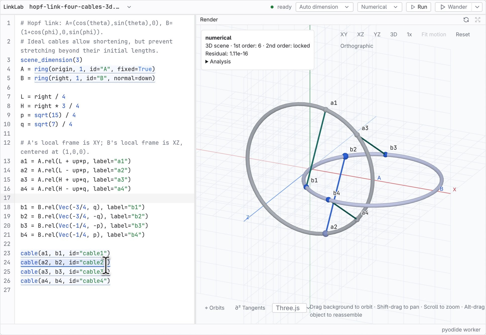

# LinkLab

Explore rigid linkages, constraints, and their motion spaces in 2D and 3D.



## Overview

LinkLab is an interactive browser-based kinematics workbench. You define rigid bodies, joints, bars, rings, and ideal cables using a Python DSL, and LinkLab analyzes their degrees of freedom (first- and second-order mobility) and lets you interactively drag, orbit, or wander through their configuration space.

- **Python DSL & Editor**: Write and live-edit scenes in a CodeMirror editor, executed in-browser via a Pyodide Web Worker.
- **2D & 3D Visualization**: Inspect linkages, attachment points, and tangent/orbit previews with Three.js.
- **Motion Analysis**: Detect free motions, locked configurations, and explore valid motions interactively.

## Getting Started

```bash
bun install
bun run dev
```

To build for production:

```bash
bun run build
```

## License

[MIT](LICENSE)
